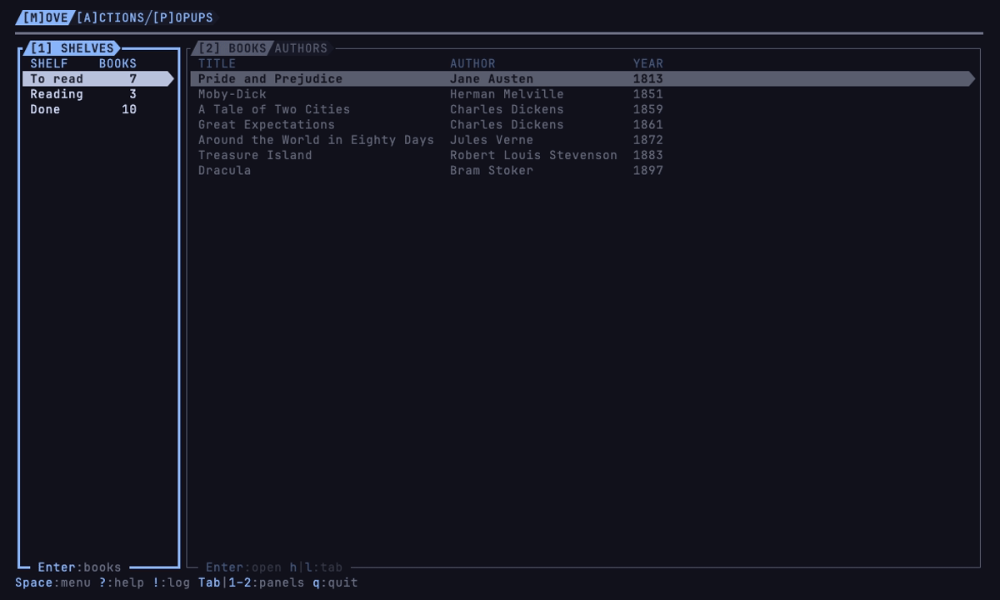

# demou

[](https://github.com/vulcanshen/demou/releases)
[](LICENSE)

**Language**: [English](README.md) · 繁體中文

**家族的操作教學 app：動手按，學會 terminu 家族的操作。**

terminu 家族的每一個 app 操作都一樣：同一組鍵用來移動、找出能做的事、關掉打開的東西。demou 是一個拿來練這些鍵的書架，
一個畫面練一部分：看與移動、找動作、popup 疊 popup。家族的影片用的就是它，裝起來可以跟著按。它什麼都不存：每次啟動都是
同一個放著二十本經典的書架。



## 特色

- **三個畫面，一個畫面一課**：`[M]ove` 看與移動、`[A]ctions` 找動作、`[P]opups` popup 疊 popup。
- **學會的在家族每個 app 都能用**：kbu、filu、sshu 等成員的 `Space`、`?`、`!`、`Tab`、`Enter`、`Esc` 都一樣。
- **怎麼按都不怕**：書是練習用的假資料，只在 demou 開著時存在；它不碰你的任何檔案。

## 安裝

### 前置需求

- macOS 或 Linux（WSL 也可以）。
- [Nerd Font](https://www.nerdfonts.com) 的終端機設定檔：icon 與框線都是 Nerd Font 的字。
- truecolor（24-bit 色）的終端機：淡化的顏色與層色在 256 色下分不出來。
- 至少 60 欄寬、24 列高的終端機；比這小時 demou 只顯示名稱、需要的大小與怎麼離開，終端機拉大就回到原來的樣子。

demou 啟動時會量 icon 與 powerline 符號佔幾格。量錯時自己設：

| 變數 | 設的是 |
|---|---|
| `DEMOU__ICON_WIDTH` | icon 佔幾格，只給 demou |
| `DEMOU__POWERLINE_WIDTH` | powerline 符號佔幾格，只給 demou |
| `TERMINU__ICON_WIDTH` | icon 佔幾格，給 terminu 家族每一個 app：設一次，全家族都讀到 |
| `TERMINU__POWERLINE_WIDTH` | powerline 符號佔幾格，給 terminu 家族每一個 app |
| `LC_TERMINU_ICON_WIDTH` | icon 佔幾格，由有 ssh 的家族 app 隔著 ssh 帶過來 |
| `LC_TERMINU_POWERLINE_WIDTH` | powerline 符號佔幾格，由有 ssh 的家族 app 隔著 ssh 帶過來 |

icon 與 powerline 符號各自照表上的順序，用第一個有設的；都沒設才自己量。在家族 app 的終端機裡跑時，`TERMINU__` 的兩個由外層的 app 替它設好；從家族 app 隔著 ssh
連過來時，帶過來的是 `LC_TERMINU_` 的兩個。

### Homebrew

```sh
brew install vulcanshen/tap/demou
```

### 安裝腳本

```sh
curl -fsSL https://raw.githubusercontent.com/vulcanshen/demou/main/install.sh | sh
```

不用 sudo：裝到 `~/.local/bin`。

### 第一次啟動

demou 打開 `[M]ove` 畫面與書架。它不寫任何東西：離開再打開，書架回到原來的樣子。

### 移除

```sh
brew uninstall demou
```

用安裝腳本裝的：

```sh
curl -fsSL https://raw.githubusercontent.com/vulcanshen/demou/main/uninstall.sh | sh
```

## 快速開始

1. 執行 `demou`。
2. 按 `j`、`k` 換書架，按 `Tab` 到書那邊。
3. 按 `Space` 看這裡能做什麼，按 `?` 看這裡能按哪些鍵。
4. 按 `A`、`P` 到另外兩個畫面，按 `M` 回來。
5. 按 `q` 離開；demou 會先問。

## 使用方式

```
demou            啟動
demou version    印出版號（-v、--version）
demou help       印出命令列的用法（-h、--help）
```

家族共用的鍵：

| 鍵 | 做什麼 |
|---|---|
| `Space` | 這裡能做什麼：對這一項、對這個 panel、對整個 app |
| `?` | 這裡能按的每一個鍵 |
| `!` | App Log：做過的事，最新的在最下面；在這裡是換過的畫面、打開過的第一頁與作者，以及搬、拿掉、加進來、排序過的書 |
| `Tab`、`1`–`9` | 下一個 panel；照編號跳到某個 panel |
| `j\|k`、`h\|l` | 移動；`h\|l` 切 tab；走過最後一個就回到第一個 |
| `gg\|G` | 到最上面、到最下面 |
| `Enter` | 最直觀的那件事：在這裡是打開那本書的第一頁 |
| `v`、`y` | 在一頁文字上：按 `v`、移到起點，再按 `v`、移動選取；`y` 複製 |
| `/`、`n\|N` | 在一頁文字、App Log 與 `?` 上：找字；`n\|N` 跳到下一筆、上一筆 |
| `Esc` | 關掉最上層的 popup，一次一層；不會離開 demou |
| `q` | 離開，先問 |

demou 自己的：

| 鍵 | 在哪裡 | 做什麼 |
|---|---|---|
| `M`、`A`、`P` | 每個畫面 | 到 `[M]ove`、`[A]ctions`、`[P]opups` 畫面 |
| `b`、`f` | `[A]ctions` | 開始讀（移到 Reading）、讀完（移到 Done） |
| `s` | `[A]ctions` | 按年份排，再按一次回到按書名 |
| `r` | `[P]opups` | 把書拿掉，先問 |
| `n` | `[P]opups` | 加一本書：NEW BOOK 表單 |

## 設定與資料

demou 沒有設定，也不存資料：書只在記憶體裡，改過的離開就不見了。它沒有用到家族共用的設定 key。

## 限制

- 書架是練習用的：加的、搬的、拿掉的書，離開 demou 就不見了。
- 只有 macOS 與 Linux（WSL 也可以），沒有 Windows 版。

## 相關連結

- [CHANGELOG](CHANGELOG.md)

## terminu family

demou 遵循 terminu design：

- [terminu design](https://github.com/vulcanshen/terminu)：家族的設計規範
- [terminu-go](https://github.com/vulcanshen/terminu-go)：demou 用來做成的 Go 函式庫
- [terminu-harness](https://github.com/vulcanshen/terminu-harness)：照 terminu design 做 app 的 Claude Code plugin

## License

[GPL-3.0](LICENSE)
