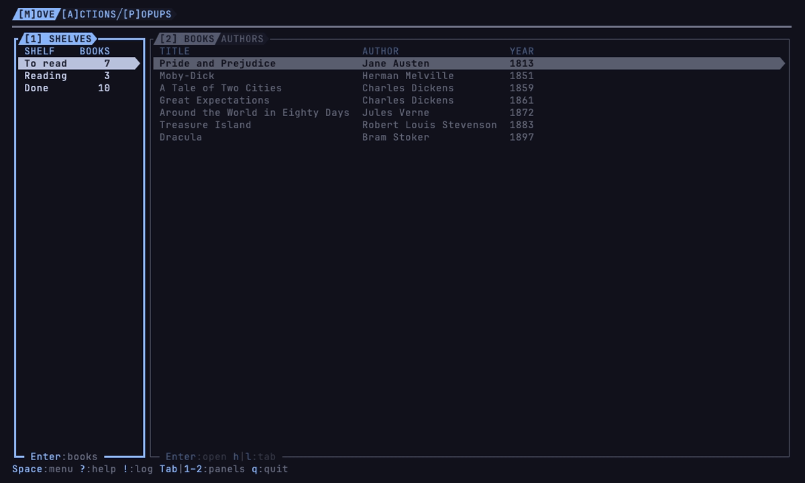

# demou

[](https://github.com/vulcanshen/demou/releases)
[](LICENSE)

**Language**: English · [繁體中文](README-zh_TW.md)

**The terminu family's app for learning the operations, hands-on.**

Every app in the terminu family works the same way: the same keys move you around, find what you can do and close what
you opened. demou is a bookshelf to practise them on, one screen for each part: looking around and moving, finding what
you can do, and popups over popups. It is the app in the family's videos; install it and press along. Nothing is saved:
every start is the same shelf of twenty classics.



## Features

- **Three screens, one lesson each**: `[M]ove` to look around and move, `[A]ctions` to find what you can do, `[P]opups` for
  popups over popups.
- **What you learn works in every family app**: the same `Space`, `?`, `Tab`, `Enter` and `Esc` in kbu, filu, sshu and the
  rest.
- **Safe to press anything**: the books are made up for practice and live only while demou runs; it never touches your files.

## Install

### Requirements

- macOS or Linux (WSL too).
- A [Nerd Font](https://www.nerdfonts.com) terminal profile: the icons and the frames are Nerd Font glyphs.
- A truecolor (24-bit) terminal: the faded colours and the layer colours cannot be told apart in 256 colours.

demou measures how many cells an icon and a powerline symbol take when it starts. When it gets them wrong, set them:

| Variable | What it sets |
|---|---|
| `DEMOU__ICON_WIDTH` | The cells an icon takes, for demou |
| `DEMOU__POWERLINE_WIDTH` | The cells a powerline symbol takes, for demou |
| `TERMINU__ICON_WIDTH` | The cells an icon takes, for every terminu family app: set it once and they all read it |
| `TERMINU__POWERLINE_WIDTH` | The cells a powerline symbol takes, for every terminu family app |

Run inside a family app's terminal, demou gets the `TERMINU__` ones from the app around it.

### Homebrew

```sh
brew install vulcanshen/tap/demou
```

### Script

```sh
curl -fsSL https://raw.githubusercontent.com/vulcanshen/demou/main/install.sh | sh
```

No sudo: it installs to `~/.local/bin`.

### Go

```sh
go install github.com/vulcanshen/demou/cmd/demou@latest
```

### The first start

demou opens on the `[M]ove` screen with the bookshelf. It writes nothing anywhere: quit and start again, and the shelf is
back as it was.

### Uninstall

```sh
brew uninstall demou
```

Installed with the script:

```sh
curl -fsSL https://raw.githubusercontent.com/vulcanshen/demou/main/uninstall.sh | sh
```

## Quick start

1. Run `demou`.
2. Press `j` and `k` to go through the shelves, `Tab` to go over to the books.
3. Press `Space` to see what you can do here, `?` to see every key that works here.
4. Press `A` and `P` for the other two screens, `M` to come back.
5. Press `q` to quit; demou asks first.

## Usage

```
demou            start
demou version    print the version (-v, --version)
demou help       print the command-line usage (-h, --help)
```

The keys every family app shares:

| Key | What it does |
|---|---|
| `Space` | What you can do here: on this item, on this panel, and for the whole app |
| `?` | Every key that works here |
| `Tab`, `1`–`9` | The next panel; jump to a panel by its number |
| `j\|k`, `h\|l` | Move; `h\|l` switch tabs; past the last one you are back at the first |
| `gg`, `G` | To the top, to the bottom |
| `Enter` | The obvious thing: here, open the book at its first page |
| `Esc` | Close the popup on top, one at a time; it never leaves demou |
| `q` | Quit, after asking |

demou's own:

| Key | Where | What it does |
|---|---|---|
| `M`, `A`, `P` | everywhere | The `[M]ove`, `[A]ctions` and `[P]opups` screens |
| `b`, `f` | `[A]ctions` | Begin the book (to Reading), finish it (to Done) |
| `s` | `[A]ctions` | Sort by year, or by title again |
| `r` | `[P]opups` | Remove the book, after asking |
| `n` | `[P]opups` | A new book: the NEW BOOK form |

## Settings and data

demou keeps no settings and no data: the books live in memory, and what you change is gone when it quits. It uses none of
the family's shared setting keys.

## Limits

- The bookshelf is for practice: what you add, move or remove is gone when demou quits.
- macOS and Linux only (WSL too); there is no Windows build.

## Links

- [CHANGELOG](CHANGELOG.md)
- [Developer notes](docs/dev-remarks.md) (in Traditional Chinese)

## The terminu family

demou follows [terminu design](https://github.com/vulcanshen/terminu) and is built with
[terminu-go](https://github.com/vulcanshen/terminu-go). The other apps in the family:

| App | What it is |
|---|---|
| [kbu](https://github.com/vulcanshen/kbu) | A Kubernetes TUI dashboard |
| [filu](https://github.com/vulcanshen/filu) | A terminal file manager you don't have to learn |
| [sshu](https://github.com/vulcanshen/sshu) | A terminal front end for ssh and sftp |
| [webu](https://github.com/vulcanshen/webu) | A terminal browser that reads a web page as a document |
| [locku](https://github.com/vulcanshen/locku) | A screensaver with a PIN lock, for the terminal |
| [kamonu](https://github.com/vulcanshen/kamonu) | A terminal editor for the family's marks (kamon), drawn letter by letter |
| [ccdrawu](https://github.com/vulcanshen/ccdrawu) | A sidebar for Claude Code: usage, context, cost and git beside the transcript |

## License

[GPL-3.0](LICENSE)
